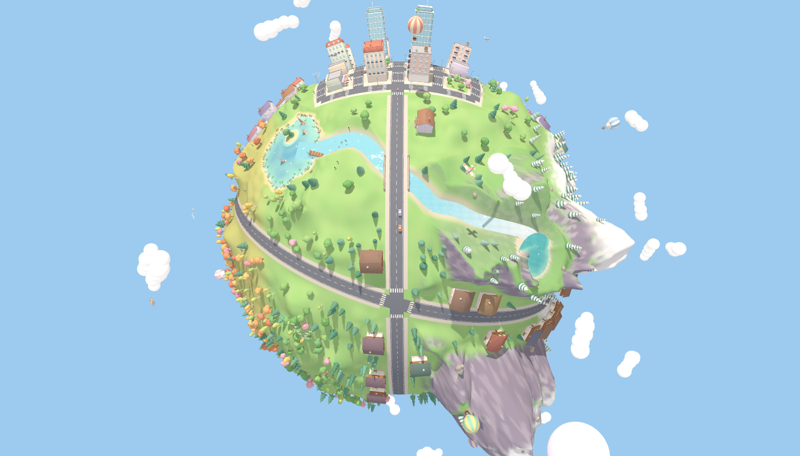
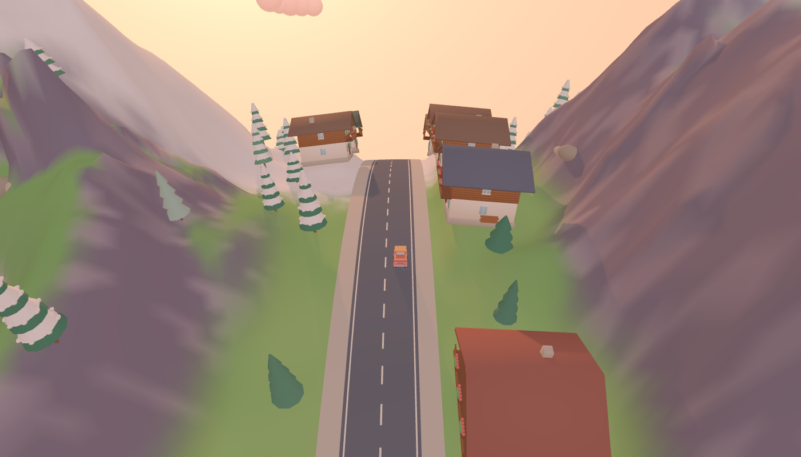
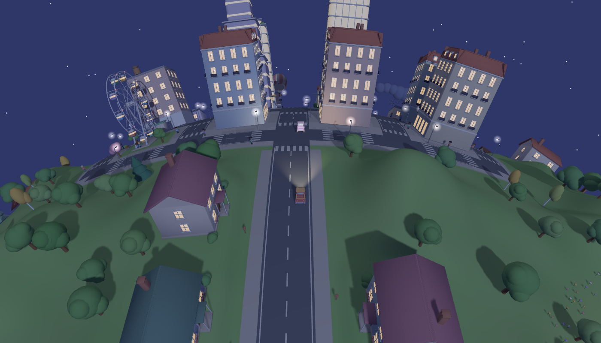
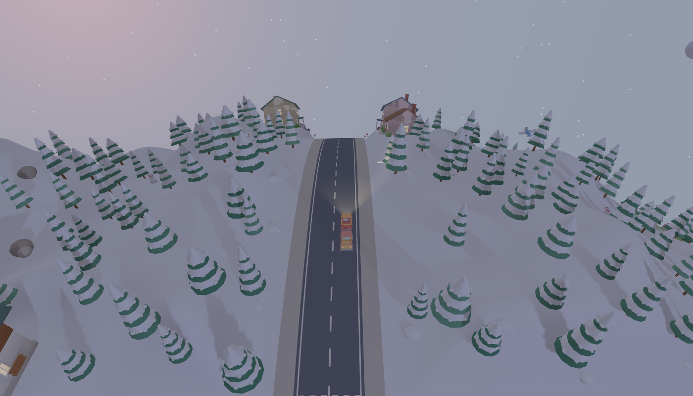
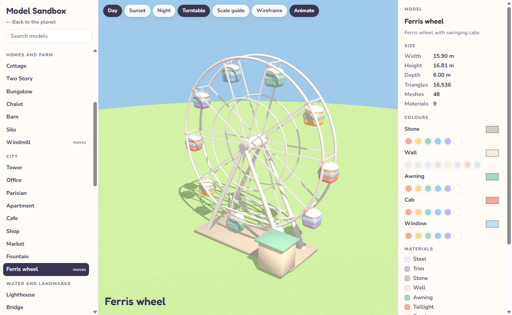
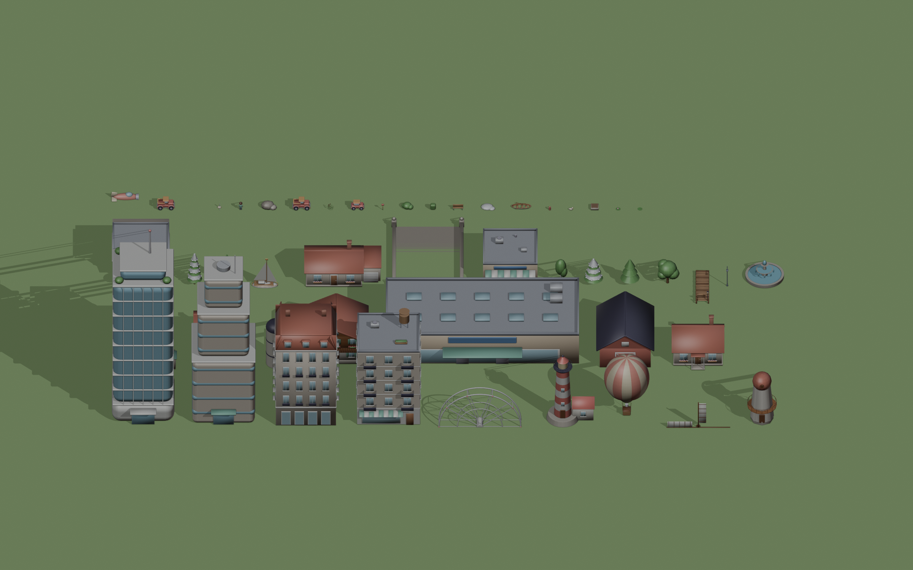

<div align="center">

# 🌍 Our Planet

### A tiny, cozy world to drive around — a love letter to the beautiful planet we live on.



*Snowy Alps, a winding river, turquoise lakes, a pastel city, farms, a flower meadow and autumn woods — all on one little globe you can drive around in under a minute.*

[**Play**](#run-it-locally) · [**Places to visit**](#places-to-visit) · [**Model sandbox**](#the-model-sandbox) · [**How it's made**](#how-its-made)


</div>

---

## Why

The idea behind this project is simple: **to bring out our beautiful planet.** Mountains catching the last light, ducklings following their mother across a lake, windows glowing on a city street at night, a little plane towing a banner across the sky. Everything is soft, rounded and pastel, so the world feels like a toy you want to hold, and every corner has something small to notice.

You explore it in a chunky little pickup truck.

<table>
<tr>
<td width="50%"></td>
<td width="50%"></td>
</tr>
<tr>
<td align="center"><sub><b>Sunset in the Sugarcrest Alps</b></sub></td>
<td align="center"><sub><b>Pastel City at night</b></sub></td>
</tr>
</table>

## Places to visit

| | Place | What you'll find |
|---|---|---|
| 🏔️ | **Sugarcrest Alps** | Sharp, snow-capped peaks led by the 76 m Sugarhorn, a road through a deep gorge, Swiss chalets with geraniums on the balconies, snow-laden pine forests |
| 💧 | **Alpine lake** | A turquoise lake high in the mountains, where Ribbon River begins |
| 🌊 | **Ribbon River** | Rushes white down the foothills, winds through the lowlands and passes under a stone arch bridge |
| ⛵ | **Lake Lull** | Sailboats, a striped lighthouse with a rotating beam, a wooden pier, reeds, lily pads and duck families |
| 🍁 | **Maple Lake** | A quiet lake in the autumn woods with a little island and a drifting rowboat |
| 🏙️ | **Pastel City** | Glass towers, Paris-style apartments, cafés, a fountain plaza, a Ferris wheel and people strolling the sidewalks |
| 🏡 | **Suburbs** | Cottages and bungalows on rolling hills, mailboxes, parked cars |
| 🌾 | **Butter Farms** | Striped crop fields, red barns, silos and turning windmills |
| 🌸 | **Petal Meadow** | Hundreds of flowers and a few benches |
| ❄️ | **Snowy North** | Snow-laden pines, snow mounds, snowmen and long polar twilight |
| 🍂 | **Autumn Woods** | Orange, pink and gold trees, birches and mossy boulders |

Overhead, **hot air balloons** drift, **little planes** circle the globe (one towing an *Our Beautiful Planet ♥* banner), **flocks of birds** fly in V formation and clouds catch on the peaks. Other cars share the roads and brake when you're in the way.



## Day and night

The sun really circles the planet, so the time of day depends on where you are. Drive west and you can chase the sunset.

- 🌅 Golden hour with a warm glow on the horizon and long shadows
- 🌙 Night with stars, a moon, glowing windows, street lamps and truck headlights
- ⏱️ A full day lasts about ten minutes and lingers around sunrise and sunset
- Pick **Auto**, **Day**, **Sunset** or **Night** in the panel; the clock sits next to the speedometer

## Music and sound

Soft, soothing music is generated live in the browser: pad chords, music-box notes on a pentatonic scale, a gentle bass line, warm reverb and echo. It swells as you drive and fades to a whisper when you stop. At night it slows down and turns softer and dreamier, and a faint shaker joins when you pick up speed. Underneath sit quiet ambient sounds: a gentle engine purr, wind in the mountains and the snow, birdsong by day and crickets at night. Toggle **Music** and **Sounds** in the panel; audio starts on your first click or key press, as browsers require.

## Controls

| Key | Action |
|---|---|
| <kbd>W</kbd> <kbd>A</kbd> <kbd>S</kbd> <kbd>D</kbd> or arrows | Drive |
| <kbd>Space</kbd> | Handbrake (drift and leave skid marks) |
| <kbd>C</kbd> | Cycle cameras: chase, top-down, driver seat |
| Drag (driver view) | Look around from the driver seat |
| Mouse wheel | Zoom (all the way out to see the whole planet) |
| Touch buttons | Drive on phones and tablets |

The **Go to** buttons jump straight to the Alps, the lakes, the farm, the meadow or the poles. The truck follows the terrain: it tilts on slopes, slows uphill, rolls back on steep mountainsides and gets bogged down in water.

## Run it locally

No build step and no install. It's plain HTML and JavaScript with three.js from a CDN.

```bash
git clone https://github.com/Sadique523/our-planet.git
cd our-planet
node tools/serve.js          # → http://localhost:8080
```

Any static web server works (`npx serve`, `python -m http.server`, …). Browsers won't load the 3D models from `file://`, so open the page through a server.

## The model sandbox



[`sandbox.html`](sandbox.html) shows every model in the world on a turntable, so each one can be refined over time.

- Browse by category, or search
- Moving models play their animation: the truck's wheels, the Ferris wheel, the windmill and the plane's propeller
- Recolour any tintable part (walls, roofs, leaves, car paint, sails…) with palette chips or a colour picker
- Check the width, height, depth and triangle count of each model
- Preview it in **Day**, **Sunset** or **Night** light, show a person for scale, toggle wireframe
- Link straight to a model: `sandbox.html#Chalet`

## How it's made

### 🎨 Models are built in Blender, from code

Every model is generated by a Python script that runs Blender in the background: the truck, houses, chalets, towers, trees, boats, the bridge, the lighthouse, people, ducks and planes. Rounded shapes get exact custom normals, so they shade softly without lumps.



```bash
# rebuild the kit (Windows, Blender from the Microsoft Store)
blender-launcher.exe --background --factory-startup --python tools/make_kit.py -- assets
node tools/glb2json.js       # also write assets/kit.json for hosts that don't serve .glb
```

`assets/kit.blend` holds every model laid out in rows, ready to open and inspect in Blender.

### 🌐 The planet is generated in the browser

- **Terrain:** a cube-sphere with about 170,000 vertices, shaped by ridged simplex noise for the mountains, faceted pyramids for the summits, rolling hills, lake basins with noisy shorelines and islands, and a river carved along a spline. Building sites get flattened pads so houses sit on terraces.
- **Roads:** great circles and arcs, painted as strips that hug the curve. The city grid uses a gnomonic projection, so its streets are perfectly straight.
- **Water:** colour shifts with depth, a foam line follows the shore, and a small shader adds moving ripples and glints.
- **Life:** people, traffic, boats, ducks and birds are instanced and animated every frame. Static scenery is instanced per region, so the camera only draws what it can see.
- **Driving:** the truck moves on the sphere using quaternions, with grip, drift and slope gravity, and it collides with buildings, trees and other cars.

### Project layout

```
index.html            the game page
sandbox.html          the model sandbox
src/game.js           planet, terrain, roads, life, day/night, driving, camera
src/sandbox.js        sandbox viewer
src/audio.js          generative music and ambient sound (Web Audio)
src/shared.js         small models built in code and shared settings
assets/kit.glb        every Blender model (kit.json is the same data as JSON)
assets/kit.blend      the Blender file
tools/make_kit.py     builds the vehicles, houses, shops, nature and street furniture
tools/kit_world.py    builds the city, chalets, bridge, landmarks, boats, people, planes, snowy trees
tools/glb2json.js     converts the kit for hosts that can't serve .glb
tools/serve.js        tiny local web server
concepts/             earlier prototypes (flat town, first tiny planet)
```

## Ideas for what's next

- 🦌 More wildlife: deer in the forests, fish jumping in the lakes, butterflies in the meadow
- 🌸 Seasons: cherry blossom in spring, snow spreading in winter
- 📸 A photo mode and spots to discover: the Sugarhorn summit, the waterfall, the duck families
- 🚡 A gondola up the mountain
- 🎵 Gentle sounds: wind in the Alps, waves on the lake, a quiet city at night

---

<div align="center">
<sub>Made with care for the one planet we all share. 🌱</sub>
</div>
